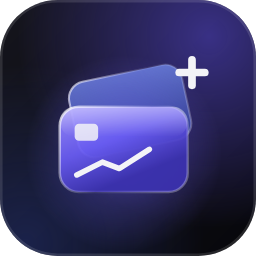
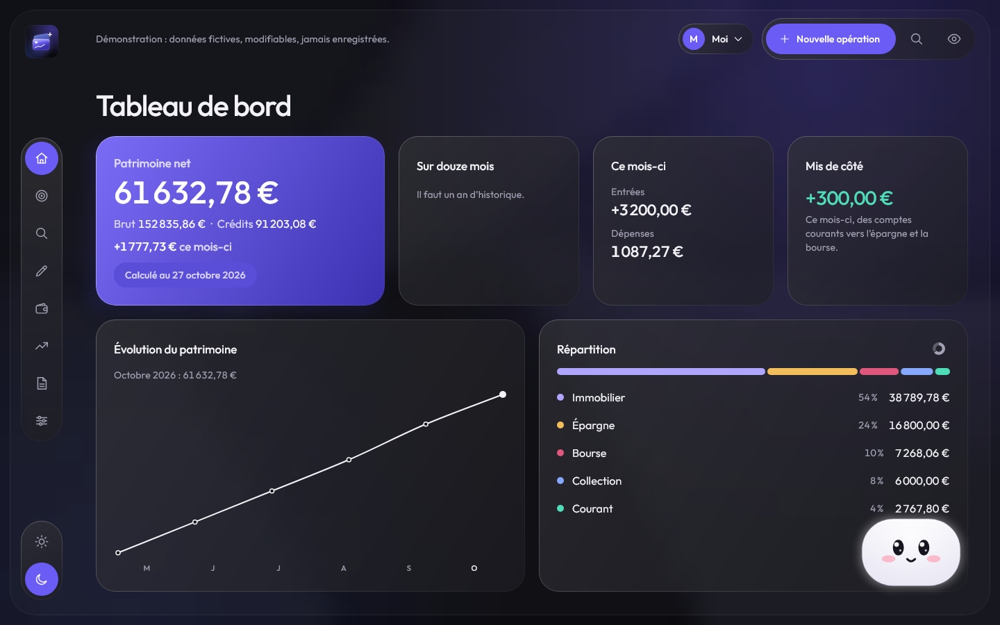
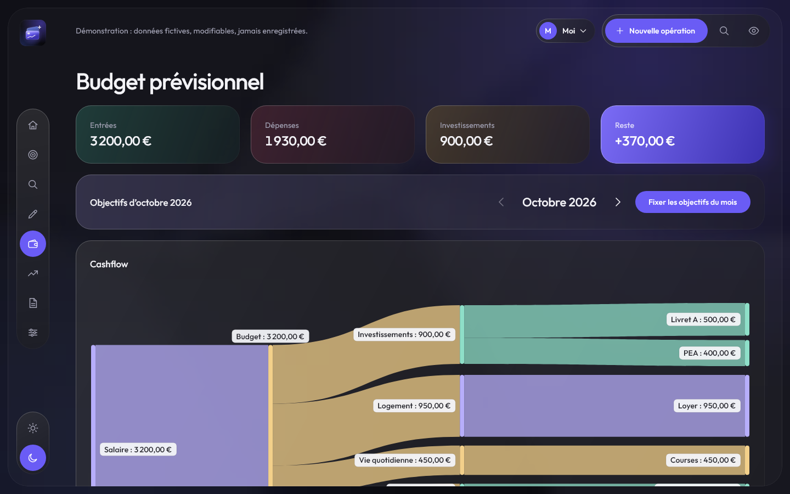
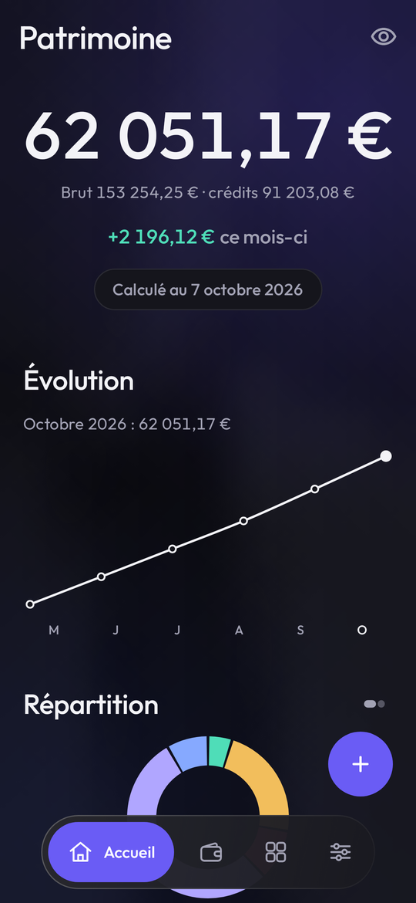

<p align="center">
  
</p>

<h1 align="center">PatrimoinePlus</h1>

<p align="center">
  Le patrimoine et les dépenses de toute la famille, sur le téléphone et sur le PC.<br>
  Vos données restent chez vous : pas de compte, pas de cloud.
</p>

<p align="center">
  <a href="https://github.com/Maubin76/PatrimoinePlus/actions/workflows/ci.yml"></a>
  <a href="https://github.com/Maubin76/PatrimoinePlus/releases/latest"></a>
  
  
</p>

<p align="center">
  
</p>

<table>
  <tr>
    <td width="68%"></td>
    <td width="32%"></td>
  </tr>
  <tr>
    <td align="center"><sub>PC : budget prévisionnel et schéma de cashflow</sub></td>
    <td align="center"><sub>Téléphone : accueil</sub></td>
  </tr>
</table>

## En bref

PatrimoinePlus suit vos comptes courants, livrets, PEA et comptes-titres,
biens immobiliers, objets de collection et crédits, et calcule votre
**patrimoine net** jour après jour.

- **Au quotidien, sur le téléphone** : saisie rapide des dépenses, solde de
  chaque compte, cours de bourse mis à jour tout seuls.
- **Pour piloter, sur le PC** : un tableau de bord sur grand écran, le
  budget, les objectifs, les bilans et la projection.
- **Les deux restent synchronisés** par le Wi-Fi de la maison, sans serveur
  ni appli tierce : le téléphone fait le relais entre les PC de la famille.
  Une seule base pour toute la famille, avec un profil par personne et une
  vue Famille.
- **Vos données restent privées** : elles ne quittent pas vos appareils.
  Seuls les cours des titres (codes ISIN, jamais de montant) et la recherche
  des mises à jour passent par internet.

## Fonctionnalités

| Fonctionnalité | Description | Android | PC |
|---|---|:---:|:---:|
| **Comptes** | Courant, épargne, bourse, immobilier, collection et crédit ; réordonnables, archivables | ✅ | ✅ |
| **Patrimoine net** | Total, variation du mois, évolution sur douze mois, brut et crédits déduits | ✅ | ✅ |
| **Répartition** | Par type de compte et par titre, en barre ou en cercle au choix | ✅ | ✅ |
| **Saisie des opérations** | Dépense, revenu, virement, ordre de bourse, mensualité de crédit ; libellés et catégories suggérés | ✅ | ✅ |
| **Saisie rapide en grille** | Dépenses et revenus en série au clavier, catégorie proposée d'après le libellé | — | ✅ |
| **Opérations récurrentes** | Loyer, salaire, abonnements… créés tout seuls chaque mois, trimestre ou année | ✅ | ✅ |
| **Crédits** | Tableau d'amortissement, mensualités automatiques, capital restant dû, valeur nette du bien financé | ✅ | ✅ |
| **Biens** | Achat et vente de biens immobiliers ou d'objets de collection, plus-values | ✅ | ✅ |
| **Bourse et livrets** | Positions, prix de revient, plus-values latentes et réalisées ; relevés et intérêts des livrets | ✅ | ✅ |
| **Cours automatiques** | Cours des titres récupérés chaque jour par leur ISIN, historique compris | ✅ | ✅ |
| **Catégories** | Personnalisables, avec icônes ; réaffectation des opérations à la suppression | ✅ | ✅ |
| **Profils et vue Famille** | Un profil par personne, comptes partagés avec la part de chacun, vue d'ensemble de la famille | ✅ | ✅ |
| **Budget prévisionnel** | Mois type en entrées, dépenses par thème et investissements, schéma de cashflow | — | ✅ |
| **Objectifs** | Objectifs chiffrés (épargne, patrimoine, taux d'épargne…) et objectifs du mois suivis sur les opérations | — | ✅ |
| **Bilan mois par mois** | Dépenses et revenus sur douze mois, taux d'épargne, tableau catégories × mois | — | ✅ |
| **Bilan annuel** | Patrimoine de début et de fin d'année, revenus, dépenses, plus-values, crédits ; export PDF | — | ✅ |
| **Projection** | Patrimoine estimé à 5, 10, 20 ou 30 ans selon trois scénarios | — | ✅ |
| **Recherche** | Recherche multicritère dans toutes les opérations, modification ou suppression groupée | — | ✅ |
| **Rapprochement bancaire** | Comparaison avec le relevé CSV de la banque, création des opérations manquantes | — | ✅ |
| **Synchronisation Wi-Fi** | Appairage par QR code, échanges chiffrés sur le Wi-Fi de la maison seulement, en tâche de fond ; fusion élément par élément, choix demandé si un même élément a changé des deux côtés | ✅ | ✅ |
| **Écosystème** | Schéma des PC et téléphones appairés, date de leur dernière synchronisation, historique des modifications | — | ✅ |
| **Zone de notification** | Fermer la fenêtre garde l'appli près de l'horloge pour le téléphone ; démarrage avec Windows au choix | — | ✅ |
| **Sauvegarde automatique** | Une sauvegarde par jour en classeur Excel lisible (téléphone : les 3 dernières ; PC : les 7 dernières, dans « Sauvegardes PC ») | ✅ | ✅ |
| **Import d'une sauvegarde** | Restauration d'un classeur, entièrement vérifiée avant de remplacer les données | ✅ | — |
| **Mode discret** | Masque tous les montants d'un geste | ✅ | ✅ |
| **Verrou** | Empreinte ou code du téléphone à l'ouverture | ✅ | — |
| **Thèmes** | Monochrome, Minimal ou Coloré, clair ou sombre, effet verre | ✅ | ✅ |
| **Thèmes personnalisés** | Cinq couleurs au choix, partagées entre le téléphone et le PC | ✅ | ✅ |
| **Assistant** | Petit compagnon animé qui résume le mois (budget, objectifs, patrimoine) et réagit aux événements | — | ✅ |
| **Visites guidées** | Présentation de chaque page à la première visite, à revoir depuis les réglages | — | ✅ |
| **Premier lancement** | Assistant de départ qui propose les comptes et les catégories | ✅ | — |
| **Démonstration** | Données fictives pour essayer l'application sans rien saisir | — | ✅ |
| **Mises à jour** | Nouvelle version proposée au lancement, téléchargée et installée depuis GitHub | ✅ | ✅ |

## Installation

Téléchargez la [dernière version](https://github.com/Maubin76/PatrimoinePlus/releases/latest) :

- **Android** : `PatrimoinePlus-X.Y.apk`, à installer sur le téléphone
  (autoriser l'installation depuis cette source).
- **PC Windows** : `PatrimoinePlus-X.Y-windows.zip`, à décompresser
  n'importe où, puis lancer `PatrimoinePlus.exe`. Rien à installer, Java est
  inclus. Windows peut afficher un avertissement au premier lancement
  (« Informations complémentaires › Exécuter quand même »).

Ensuite, chaque application propose elle-même les nouvelles versions.
Mettez à jour le téléphone et le PC ensemble : ils doivent lire le même
format de fichier.

Pour relier le téléphone et un PC : sur le PC, page **Appareils** ›
« Activer » puis « Appairer le téléphone » ; sur le téléphone, Réglages ›
Synchronisation Wi-Fi › « Scanner le QR code ». Recommencez avec chaque PC :
le téléphone porte ensuite les modifications de l'un à l'autre (voir la
[mise en place pas à pas](doc/DEVELOPPEMENT.md#mise-en-place-de-la-synchronisation-wi-fi)).

## Développement

Kotlin, Jetpack Compose (Android) et Compose Multiplatform (PC), avec un
cœur partagé entre les deux applications.

```bash
./gradlew :app:assembleDebug     # APK Android de développement
./gradlew :desktop:run           # application PC
./gradlew :core:test :desktop:test :app:testDebugUnitTest   # tests
```

- [Documentation technique](doc/DEVELOPPEMENT.md) : construction,
  publication, architecture, modèle de données, synchronisation.
- [Couverture des tests](doc/TESTS.md) et
  [plan de tests manuels](doc/PLAN_DE_TESTS.md).
- [Spécification](doc/SPEC.md).
